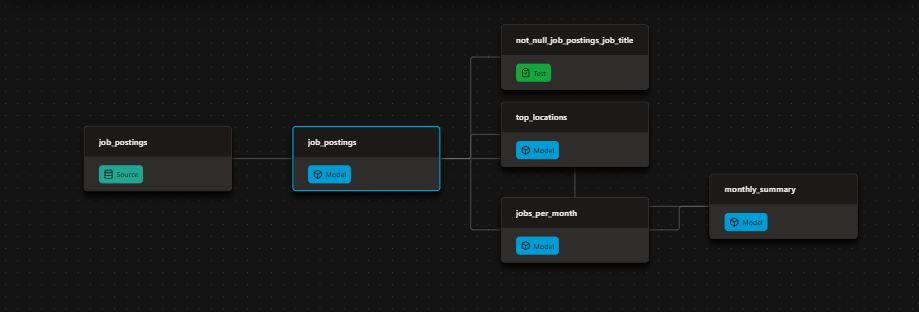

# 📊 DBT and DuckDB Automated Analytics Pipeline

> A modern data pipeline that transforms raw job postings into a tested, structured data warehouse using **dbt and DuckDB**, fully automated via **GitHub Actions**.

- **Models data** into staging views and final Mart tables (`jobs_per_month`, `top_job_locations`, `monthly_summary`) using dbt's Jinja `ref()` for dependencies.
- **Ensures data quality** with `unique` and `not_null` tests, and pushes column descriptions to the database using `persist_docs`.
- **Automates runs** on every push and weekly via GitHub Actions, publishing the final `prod.duckdb` database to GitHub Releases.

### 🗺️ What I Built

| Component | Implementation | Where to Find It |
| :--- | :--- | :--- |
| **dbt Pipeline** | Raw sources flow into a cleaned staging view, then into aggregated mart tables (`jobs_per_month`, `top_locations`, `remote_share`). | [analytics/models](analytics/models) |
| **Data Tests** | `unique` and `not_null` checks applied to key grains to ensure data quality. | [schema.yml](analytics/models/schema.yml) |
| **Data Dictionary** | Column descriptions pushed directly into the DuckDB schema using `persist_docs`. | `dbt docs serve` |
| **Environments** | Local development uses `dev.duckdb`; CI/CD uses a separate profile targeting `prod.duckdb`. | [ci/profiles.yml](ci/profiles.yml) |
| **Automation (CI/CD)** | GitHub Actions runs the scraper, executes `dbt build`, and publishes the DB on push and weekly cron. | [dbt_build.yml](.github/workflows/dbt_build.yml) |
| **Public Warehouse** | The final `prod.duckdb` is hosted on GitHub Releases, queryable via DuckDB `ATTACH` with no credentials. | GitHub Releases |

### ⚙️ The DBT Pipeline

The pipeline is structured into three distinct dbt layers: declared sources → cleaned staging views → aggregated insight marts. Data quality is strictly enforced, as tests are configured to gate every single build. Here is a visual of the dependency graph:

Here is a breakdown of the specific dbt features implemented:

| dbt Feature | How It Was Implemented |
| :--- | :--- |
| **Declared sources** | Raw parquet paths are defined in [_sources.yml](analytics/models/_sources.yml), eliminating the need to hardcode file locations in SQL. |
| **Model dependencies** | `ref()` is used throughout the models, allowing dbt to automatically resolve execution order and run independent models in parallel. |
| **Materializations** | The project default is set to `table` for fast querying, with an explicit override to `view` for the staging layer to save storage. |
| **Data tests** | `unique` and `not_null` tests are added to the primary grains of the mart tables inside [schema.yml](analytics/models/schema.yml). |
| **Environments** | The local `dev` target is separated from the CI `prod` target using the [ci/profiles.yml](ci/profiles.yml) file. |

Running `dbt build` compiles the Jinja SQL, materializes all models, and automatically fails the run if any data tests fail. This exact same command is used both locally and in the CI pipeline.

### 🚀 Production & CI/CD

The entire pipeline is fully automated via **GitHub Actions** (defined in `.github/workflows/dbt_build.yml`), meaning it runs in the cloud with no local machine required.

**Workflow Triggers:**
| Trigger | Action |
| :--- | :--- |
| **Push to `main`** | Full rebuild of the data warehouse. |
| **Weekly (Monday)** | Scheduled rebuild to keep the data fresh. |
| **Manual (`workflow_dispatch`)** | A "Run workflow" button in the GitHub Actions UI. |

**On each run, the Action executes the following steps:**
1. Installs dependencies using `uv`.
2. Runs the Python scraper to download the latest raw `.parquet` files.
3. Executes `dbt build` using the committed CI profile `ci/profiles.yml` targeting production.
4. Publishes the resulting `prod.duckdb` file as a GitHub Release asset.

### 📖 Documentation

Interactive documentation is generated using `dbt docs generate` and hosted on **GitHub Pages**:

🔗 **[View the Live dbt Docs Site](YOUR_GITHUB_PAGES_LINK_HERE)**

The documentation site includes:
*   The full interactive **lineage graph** (sources → models → marts).
*   **Model and column descriptions** pulled directly from the YAML files.
*   Visual indicators for columns that have **data tests** applied.

**How it is deployed:**
1. The generated HTML and JSON files are exported from dbt's default `target/` folder into a root `docs/` folder. *(This step is required because GitHub Pages specifically looks for a `docs` folder on the main branch, not dbt's internal `target` folder).*
2. GitHub Pages is configured to serve the website directly from that `/docs` directory.
3. The moved files are verified locally by running `dbt docs serve --target-path ../docs` to ensure the site loads correctly before pushing to GitHub.